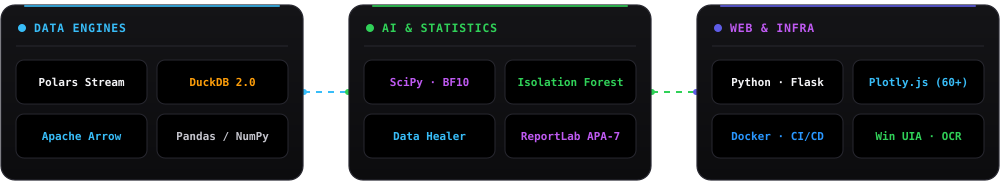

 

### ⚡ Öne Çıkan Projeler

  

  
  &nbsp;
  

### 🛠️ Teknoloji Mimarisi

  

### 💻 Sistem Özeti

### 📈 Canlı İstatistikler & Katkı Animasyonu

<picture>
  <source media="(prefers-color-scheme: dark)" srcset="https://raw.githubusercontent.com/UmutcaNN00/UmutcaNN00/output/github-contribution-grid-snake-dark.svg" />
  <source media="(prefers-color-scheme: light)" srcset="https://raw.githubusercontent.com/UmutcaNN00/UmutcaNN00/output/github-contribution-grid-snake.svg" />
  
</picture>

  

  
  &nbsp;
  

 

 

