 

 

---

### 🚀 Öne Çıkan Projeler

| Proje | Açıklama & Mimari | Durum |
|---|---|---|
| **📊 DataViz** | Kodlama gerektirmeyen, yerel-öncelikli büyük veri analitiği ve bilimsel istatistik platformu. Polars Streaming, DuckDB 2.0, PyArrow, 60 etkileşimli grafik, AI veri sağaltımı ve APA-7 PDF raporlama. | `Private · Ar-Ge` |
| [**🖥️ desktop-vision-agent**](https://github.com/UmutcaNN00/desktop-vision-agent) | Yapay zekâ ajanları için Windows masaüstü algılama, çoklu monitör yakalama, UI Automation (UIA), çevrimdışı OCR ve işletim sistemi kontrol motoru. | `Public · Python` |
| [**🗂️ Staj-Projeleri**](https://github.com/UmutcaNN00/Staj-Projeleri) | Operasyonel dijitalleşme ve veri yönetimi için LocalStorage tabanlı dinamik İK rehberi ve satın alma kayıt arayüzleri. | `Public · HTML/JS` |

---

### 🛠️ Teknoloji Yığını

  

---

### 📈 Canlı İstatistikler & Katkı Animasyonu

<picture>
  <source media="(prefers-color-scheme: dark)" srcset="https://raw.githubusercontent.com/UmutcaNN00/UmutcaNN00/output/github-contribution-grid-snake-dark.svg" />
  <source media="(prefers-color-scheme: light)" srcset="https://raw.githubusercontent.com/UmutcaNN00/UmutcaNN00/output/github-contribution-grid-snake.svg" />
  
</picture>

  

<table>
  <tr>
    <td align="center">
      
    </td>
    <td align="center">
      
    </td>
  </tr>
</table>

 

 

